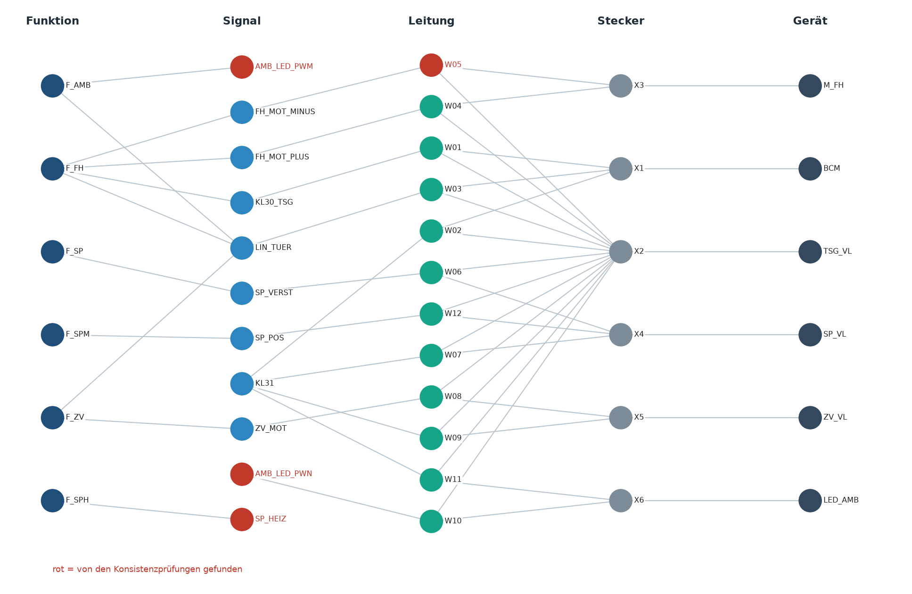

# KBL → Knowledge Graph: Mini-Demo Bordnetz

Zwei Teile, eine Ontologie:

1. **Fiktives Beispiel:** Ein Türleitungssatz (KBL-ähnlich) und ein E/E-Architekturmodell werden zu
   **einem semantischen Graphen (RDF/OWL)** verbunden und mit **SPARQL** abgefragt. Alle IDs und Werte sind erfunden.
2. **Echte KBL-Daten:** Der öffentliche Volkswagen-Beispielleitungssatz »Old Beetle« (KBL 2.4, VDA 4964)
   wird in dieselbe Ontologie überführt und auf Varianten und Konsistenz geprüft.

Es werden nur erfundene und öffentlich verfügbare Daten verwendet.

**Online ansehen:** https://suavi-yildirim.github.io/bordnetz-knowledge-graph/ (interaktive 3D-Ansicht)



## Idee

KBL beschreibt den Leitungssatz (Stecker, Kontakte, Leitungen, Module), weiß aber nichts über
Funktionen oder Steuergeräte. Das E/E-Modell kennt Funktionen und Signale, aber keine Leitungen.
Beide Welten teilen nur **Namen** (Signalnamen, Stecker-IDs, Modul-IDs). Im Graphen werden daraus
**explizite Beziehungen**. Damit lassen sich Fragen beantworten, die nur beide Sichten zusammen beantworten können.

| Quelle | Datei | Inhalt |
|---|---|---|
| Leitungssatz-Sicht | `data/door_harness_kbl.xml` | 6 Stecker, 12 Leitungen, 12 Verbindungen, 3 Module (KBL-ähnlich, stark vereinfacht) |
| E/E-Sicht | `data/ee_architecture.json` | 6 Geräte, 10 Signale, 6 Funktionen, 4 Fahrzeugkonfigurationen |
| Ontologie | `ontology/bordnetz.ttl` | 12 Klassen, 15 Objekt- und 8 Daten-Properties, Labels de/en, Naming Conventions |

## Kompetenzfragen (`src/run_queries.py`)

| # | Frage | Ergebnis im Beispiel |
|---|---|---|
| 1 | **Traceability:** Über welche Leitungen und Kontakte läuft die Funktion »Fensterheber«? | 4 Signale → W01, W03, W04, W05 |
| 2 | **Änderungsauswirkung:** Stecker X4 ändert sich. Welche Leitungen, Signale, Funktionen und Module sind betroffen? | W06, W07, W12 → Spiegelverstellung, Spiegel-Memory |
| 3a | **Varianten:** Leitungen und Leitungslänge je Konfiguration | Basis 9 Leitungen / 7,6 m … Vollausstattung 12 / 10,0 m |
| 3b | **Varianten:** Welche Funktion ist in welcher Konfiguration nicht vollständig verlegt? | Spiegelheizung (Komfort), Ambientebeleuchtung (Ambiente) |
| 4a | **Konsistenz:** Leitung dünner als vom Signal gefordert | W05: 0,35 mm² statt 1,5 mm² |
| 4b | **Konsistenz:** Signal im E/E-Modell, aber nicht verlegt | SP_HEIZ, AMB_LED_PWM |
| 4c | **Konsistenz:** Signalname im KBL, den das E/E-Modell nicht kennt | AMB_LED_PWN → Vorschlag AMB_LED_PWM |

Die drei Fehler (4a–4c) sind absichtlich in die Beispieldaten eingebaut. Sie zeigen, dass der Graph
Widersprüche zwischen den Quellsystemen sichtbar macht, die in jeder einzelnen Quelle unauffällig sind.

## Ausführen

```bash
./run.sh
```

Erzeugt `build/bordnetz.ttl` (520 Tripel, z. B. in Protégé öffnen), `build/results.md`, `build/graph.png`
sowie für die echten Daten `build/oldbeetle.ttl` und `build/results_oldbeetle.md`.

**3D-Ansicht:** online (Link oben) oder lokal `build/viewer.html` öffnen (braucht Internet für die 3D-Bibliotheken). Beide Datensätze,
Klick auf Knoten zeigt deren Tripel, die Szenario-Knöpfe spielen die SPARQL-Fragen visuell nach (inkl. Abfragetext).
Im VW-Datensatz: Röhrendicke = Leitungsquerschnitt, Farbe = Variante (MINI und MAXI / nur MAXI), Modulliste und Suche.
Ansicht **»VW Geometrie (Verlegung)«**: der Leitungssatz so, wie er im Fahrzeug verlegt ist (`src/kbl_geometry.py`).
Die Mittellinien der 183 Segmente stehen in der KBL als B-Splines (Grad 6, 7 Kontrollpunkte, ohne Knotenvektor);
als uniforme, offene B-Splines ausgewertet treffen 178 Segmente ihre Knoten exakt (Länge 99,9 % der KBL-Länge).
**5 Segmente verfehlen ihre Knoten um bis zu 494 mm**: eine Inkonsistenz zwischen Topologie und Geometrie in den
Quelldaten, rot dargestellt. Klick auf Signal, Stecker, Modul oder Abschnitt zeigt den physischen Weg der Verbindungen
(über `Routing` aus der KBL).

## Echte KBL-Daten: VW »Old Beetle« (`src/real_kbl.py`)

Quelle: [Volkswagen VOBES NG »Old Beetle« Example Files](https://ecad-wiki.prostep.org/sample/2018-12-27-volkswagen-vobesng-old-beetle/),
prostep ivip ECAD-Wiki, **CC BY-SA 4.0** (siehe `data/real/SOURCE.md`). Verwendet wird der modulare Hauptleitungssatz
(KSK, KBL 2.4): 141 Stecker, 372 Kontaktstellen, 286 Leitungen und Adern, 254 Verbindungen, 108 Signale,
34 Module mit Ausstattungscodes (PR-Nummern), 3 Konfigurationen. Ergebnis: **5 957 Tripel**.

Abbildung auf die Ontologie: `Connector_occurrence` → `bn:Connector`, `Contact_points` → `bn:ContactPoint`,
`General_wire_occurrence` / `Core_occurrence` → `bn:Wire` (+ `bn:coreOf`), `Connection` → `bn:Connection`
(+ `Signal_name`), `Module` → `bn:Module` (+ `bn:optionCode` aus `Logistic_control_information`),
`Harness_configuration` → `bn:Configuration`.

| # | Frage | Ergebnis |
|---|---|---|
| 1 | Umfang je Konfiguration | MAXI: 34 Module, 254 Verbindungen · MINI: 7 Module, 165 Verbindungen |
| 2 | Leitungslänge je Konfiguration | MAXI 278 m · MINI 218 m (+28 %) |
| 3 | Größte Module nur in MAXI | z. B. `L0L+K8S+1ZQ+8Q3` und `L0L+4GK` mit je 10 Verbindungen |
| 4 | Traceability des meistgenutzten Signals | `X.30rfg.SZS1035.`: 10 Verbindungen mit 1–6 mm², vor allem über B298 und B272 |
| 5 | Änderungsauswirkung je Stecker | TCPL.1D1: 25 Verbindungen, 11 Signale, 6 Module |
| 6a | Module ohne Inhalt | 1 Modul (`L0L+0Y1/0Y3//L0L+VC1/VC2`) hat eine Ausstattungsregel, aber keine Bauteile |
| 6b/c | Verbindungen ohne Modul / ohne zwei Kontakte | keine |
| 6d | Prüfliste: gleiches Signal, verschiedene Querschnitte | z. B. 4 Querschnitte im Netz `X.30rfg`; meist gewollt (Verzweigung) |

Grenzen: KBL enthält keine Funktionen und Steuergeräte, deshalb fehlt hier die E/E-Sicht. Einige
Verbindungsenden liegen auf Kontaktstellen außerhalb von Steckern (z. B. Sonderkontakte); sie werden noch nicht zugeordnet.

## Modellierungsentscheidungen

- **Zwei Sichten, eine Ontologie:** Leitungssatz-, E/E- und Varianten-Sicht als getrennte Klassen-Gruppen; verbunden über wenige Properties (`carriesSignal`, `pluggedInto`, `requiresModule`).
- **Verbindung als eigene Klasse:** `bn:Connection` trennt die logische Verbindung (Kontakt A → Kontakt B, Signal) von der physischen Leitung (`bn:Wire`: Querschnitt, Länge, Farbe).
- **Provenance:** Jede Aussage trägt `bn:sourceSystem` (KBL bzw. E/E). Darauf basiert die Prüfung 4c.
- **Varianten über Module:** Eine Konfiguration ist eine Menge von Modulen. Dadurch werden Prüfungen variantenbezogen (3b).
- **Naming Conventions:** Klassen in UpperCamelCase, Properties in lowerCamelCase, Instanzen als `data:<typ>/<ID>`.

## Nächste Schritte (nicht umgesetzt)

- Konsistenzregeln als **SHACL-Shapes** statt SPARQL-Abfragen
- ein E/E-Austauschformat (z. B. AUTOSAR-nah) anbinden, damit auch die echten Daten Funktionen und Steuergeräte bekommen
- Ausstattungscodes (PR-Nummern) als logische Ausdrücke auswerten statt als Text
- die VEC-Datei des Old Beetle (gesamtes Fahrzeugnetz) einbeziehen
- Software-Stände und Änderungsstände (Versionierung) modellieren
- größere Datenmengen in einem Triple Store statt im Arbeitsspeicher abfragen

## Lizenz

- Code (`src/`, `run.sh`), Ontologie und fiktive Beispieldaten: MIT-Lizenz, siehe `LICENSE`.
- Echte KBL-Dateien in `data/real/`: Volkswagen VOBES »Old Beetle« Example Files, prostep ivip ECAD-Wiki,
  [CC BY-SA 4.0](https://creativecommons.org/licenses/by-sa/4.0/). Daraus abgeleitete Daten
  (`build/oldbeetle.ttl`, `build/results_oldbeetle.md` und die eingebetteten Daten in `build/viewer.html` bzw.
  `docs/index.html`) stehen ebenfalls unter CC BY-SA 4.0.
